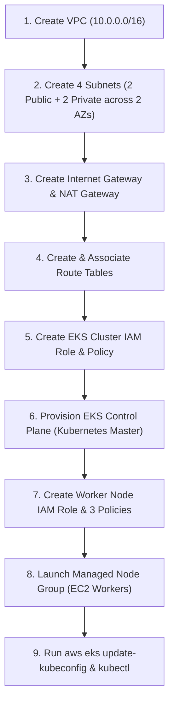

# 🚀 AWS EKS Kubernetes Cluster with Terraform (Mumbai: `ap-south-1`)

> **Buddy! 😊 This is a complete Terraform configuration for creating an AWS EKS Kubernetes cluster in Mumbai (`ap-south-1`).**  
> *Let's understand it like a real-world company setup. Below is what each section does, why we need it, and how the resources connect.*

---

## 1. First understand what we are building

Imagine a company wants to run applications using **Kubernetes on AWS**:

* **VPC** = Company's private campus.
* **Subnets** = Different sections inside the campus.
* **Internet Gateway** = Main entrance to the internet.
* **NAT Gateway** = One-way internet exit for private systems.
* **EKS Control Plane** = Manager who controls Kubernetes.
* **EC2 Worker Nodes** = Employees who run applications.
* **IAM Roles** = Identity cards that allow AWS services to perform specific work.

```
       ┌────────────────────────────────────────────────────────┐
       │                AWS CLOUD: MUMBAI                       │
       │                                                        │
       │  ┌──────────────────────────────────────────────────┐  │
       │  │ EKS CONTROL PLANE (Managed by AWS)               │  │
       │  │  • API Server                                    │  │
       │  │  • Spans across ap-south-1a & ap-south-1b        │  │
       │  └────────────────────────┬─────────────────────────┘  │
       │                           │                            │
       │   ╔═══════════════════════╪════════════════════════╗   │
       │   ║ CUSTOM VPC (10.0.0.0/16)                       ║   │
       │   ║                                                ║   │
       │   ║   PUBLIC SUBNETS (ap-south-1a & ap-south-1b)   ║   │
       │   ║    • Internet Gateway + NAT Gateway            ║   │
       │   ║    • Public Load Balancers (Ingress) live here ║   │
       │   ║                                                ║   │
       │   ║   PRIVATE SUBNETS (ap-south-1a & ap-south-1b)  ║   │
       │   ║    • EKS Worker Nodes (EC2 Instances)          ║   │
       │   ║    • Docker Containers / Pods run here         ║   │
       │   ╚════════════════════════════════════════════════╝   │
       └────────────────────────────────────────────────────────┘
```

Your Terraform code creates these resources in **seven main stages**:
1. Terraform and AWS provider setup
2. VPC networking
3. IAM role for EKS
4. EKS control plane
5. IAM role for worker nodes
6. Managed worker node group
7. Outputs for connecting to the cluster

---

## 2. Terraform and AWS provider configuration

### Your code:
```hcl
terraform {
  required_version = ">= 1.3.0"
  required_providers {
    aws = {
      source  = "hashicorp/aws"
      version = "6.73.0"
    }
  }
}

provider "aws" {
  region = "ap-south-1"
}

locals {
  cluster_name = "demo-eks-mumbai"
}
```

### 💡 Layman explanation:
Before constructing a house, you need to decide which tools and location you will use.

| Code | Simple meaning |
| :--- | :--- |
| `required_version` | Which Terraform version is acceptable |
| `required_providers` | Which cloud provider plugin is required |
| `hashicorp/aws` | AWS provider developed by HashiCorp |
| `version = "6.73.0"` | Exact AWS provider version |
| `provider "aws"` | Connect Terraform to AWS |
| `region` | Create resources in Mumbai |
| `locals` | Store a reusable value |

### Why use `locals`?
You have written:
```hcl
locals {
  cluster_name = "demo-eks-mumbai"
}
```

Instead of repeatedly typing the cluster name, you can reuse:
`local.cluster_name`

For example:
```hcl
name = "${local.cluster_name}-vpc"
```
**Result:** `demo-eks-mumbai-vpc`

> [!TIP]
> **Think of locals as a reusable label or nickname.**

---

## 3. VPC networking – Creating the campus

This is the biggest section of your code. EKS needs a network where its control plane and worker nodes can communicate.

### Your VPC:
```hcl
resource "aws_vpc" "eks_vpc" {
  cidr_block           = "10.0.0.0/16"
  enable_dns_support   = true
  enable_dns_hostnames = true
}
```

### What is a VPC?
Imagine AWS gives you a large empty plot of land. You create your own private network inside that land. That is your VPC.

| Setting | Layman explanation |
| :--- | :--- |
| `resource "aws_vpc"` | Tell Terraform to create a VPC |
| `"eks_vpc"` | Terraform's local name for this VPC |
| `cidr_block` | IP address range available inside the VPC |
| `enable_dns_support` | Allows resources to use DNS to resolve names |
| `enable_dns_hostnames` | Allows DNS hostnames for supported resources |

### What does `10.0.0.0/16` mean?
It is the IP address range for your VPC. Think of it as a large building with many rooms. You divide the building into smaller sections called **subnets**.

Your VPC contains these **four subnets**:

| Subnet Type | CIDR & Location | Purpose |
| :--- | :--- | :--- |
| **Public Subnets** | `10.0.1.0/24` – Mumbai AZ 1a<br>`10.0.2.0/24` – Mumbai AZ 1b | Used for internet-facing load balancers and the NAT Gateway. |
| **Private Subnets** | `10.0.10.0/24` – Mumbai AZ 1a<br>`10.0.20.0/24` – Mumbai AZ 1b | Used for EC2 worker nodes and application Pods. |

### Why do we need two Availability Zones?
Imagine you have two office buildings:
* Building A is in **AZ 1a**.
* Building B is in **AZ 1b**.

If one Availability Zone has a problem, resources in the other AZ can continue operating. This improves availability. It does not automatically guarantee that your applications are highly available; your workloads must also be distributed appropriately.

---

### 3.1 Internet Gateway

```hcl
resource "aws_internet_gateway" "igw" {
  vpc_id = aws_vpc.eks_vpc.id
}
```

* Think of the **Internet Gateway** as the main entrance connecting your VPC to the internet.
* Without an Internet Gateway, a public subnet cannot directly route internet traffic through the internet.
* `aws_vpc.eks_vpc.id` means: *Attach this Internet Gateway to the VPC created by the resource named `eks_vpc`.*

---

### 3.2 Public subnets

```hcl
resource "aws_subnet" "public_1" {
  vpc_id                  = aws_vpc.eks_vpc.id
  cidr_block              = "10.0.1.0/24"
  availability_zone       = "ap-south-1a"
  map_public_ip_on_launch = true
}
```

Think of a public subnet as an office area where resources can have a public internet-facing address.
* `vpc_id`: Which VPC should contain this subnet?
* `cidr_block`: What IP range should this subnet use?
* `availability_zone`: Which AWS data-centre location?
* `map_public_ip_on_launch`: Automatically assign a public IPv4 address to eligible instances launched here.

*(You create a second public subnet in `ap-south-1b` for the second AZ).*

---

### 3.3 Private subnets

```hcl
resource "aws_subnet" "private_1" {
  vpc_id            = aws_vpc.eks_vpc.id
  cidr_block        = "10.0.10.0/24"
  availability_zone = "ap-south-1a"
}
```

A private subnet is like a restricted office area. Worker nodes live here without automatically receiving public IP addresses.

#### Why put worker nodes in private subnets?
Suppose your application runs on EC2 worker nodes. You generally do not want those worker nodes directly exposed to the public internet.

Instead:
1. Users access the application through an appropriate load balancer.
2. Worker nodes remain in private subnets.
3. Worker nodes can access required external services through NAT Gateway.

> [!NOTE]
> **Important:** Private does not mean that the instances have no internet access. Your NAT Gateway provides outbound internet access.

---

### 3.4 Subnet tags – Why are they needed?

For example:
```hcl
"kubernetes.io/role/elb" = "1"
```
This tag tells Kubernetes' AWS load-balancing integrations that this subnet is suitable for **internet-facing load balancers**.

And:
```hcl
"kubernetes.io/role/internal-elb" = "1"
```
This identifies subnets suitable for **internal load balancers**.

Think of tags as **signboards**:
* `elb` = Public load balancer parking area.
* `internal-elb` = Private load balancer parking area.

The cluster ownership tag:
```hcl
"kubernetes.io/cluster/${local.cluster_name}" = "shared"
```
Identifies the subnet as associated with the cluster. The exact tag requirements can depend on the AWS load-balancer controller and cluster configuration.

---

## 4. NAT Gateway – How private nodes access the internet

### Your code:
```hcl
resource "aws_eip" "nat" {
  domain = "vpc"
}

resource "aws_nat_gateway" "nat" {
  allocation_id = aws_eip.nat.id
  subnet_id     = aws_subnet.public_1.id
}
```

Imagine your private EC2 worker node needs to download an NGINX container image from a container registry.
The worker node does not have its own public IP. How can it access the internet? **Through NAT Gateway.**

```
[ Worker Node in Private Subnet ]
                │
                ▼ (Outbound Request)
        [ NAT Gateway ] (in Public Subnet)
                │
                ▼ (Translates Address)
    [ Internet Gateway (IGW) ]
                │
                ▼
          [ Internet ]
```

1. Worker node sends an outbound request.
2. Request reaches the NAT Gateway.
3. NAT Gateway translates the private source address.
4. Traffic goes through the Internet Gateway.
5. It reaches the internet.
6. The response comes back through NAT Gateway.

### What is EIP?
`resource "aws_eip" "nat"`: EIP means **Elastic IP**. Think of it as a fixed public address assigned to your NAT Gateway.

* `allocation_id = aws_eip.nat.id`: It tells the NAT Gateway which Elastic IP address to use.
* `subnet_id = aws_subnet.public_1.id`: It places the NAT Gateway inside public subnet 1.

> [!WARNING]
> **Cost warning:** NAT Gateway is billed separately for its running time (~$0.045/hour = ~$32/month) and data processing. Your EIP/public IPv4 and data-transfer charges may also matter. A NAT Gateway can become one of the expensive parts of a small EKS lab.

---

## 5. Route tables – Giving traffic directions

Think of a route table like a **GPS map**. It tells network traffic where to go.

### Public route table
```hcl
resource "aws_route_table" "public" {
  vpc_id = aws_vpc.eks_vpc.id

  route {
    cidr_block = "0.0.0.0/0"
    gateway_id = aws_internet_gateway.igw.id
  }
}
```
* `cidr_block = "0.0.0.0/0"` & `gateway_id = aws_internet_gateway.igw.id`
* **Layman meaning:** If traffic is going to any destination outside the VPC, send it through the Internet Gateway. `0.0.0.0/0` means all IPv4 destinations.

### Private route table
```hcl
resource "aws_route_table" "private" {
  vpc_id = aws_vpc.eks_vpc.id

  route {
    cidr_block     = "0.0.0.0/0"
    nat_gateway_id = aws_nat_gateway.nat.id
  }
}
```
* **Meaning:** If a private worker node needs to reach an external IPv4 destination, send the traffic through NAT Gateway.

### Route table association
```hcl
resource "aws_route_table_association" "private_1" {
  subnet_id      = aws_subnet.private_1.id
  route_table_id = aws_route_table.private.id
}
```
This connects a subnet to its route table. Think of it like assigning a particular GPS route map to a particular office building.

| Subnet | Route table |
| :--- | :--- |
| **Public 1** | Public route table |
| **Public 2** | Public route table |
| **Private 1** | Private route table |
| **Private 2** | Private route table |

---

## 6. IAM role for the EKS Control Plane

```hcl
resource "aws_iam_role" "cluster" {
  name = "${local.cluster_name}-cluster-role"

  assume_role_policy = jsonencode({
    Version = "2012-10-17"
    Statement = [
      {
        Action = "sts:AssumeRole"
        Effect = "Allow"
        Principal = {
          Service = "eks.amazonaws.com"
        }
      }
    ]
  })
}
```

First, imagine AWS EKS is a **manager who controls the Kubernetes cluster**. The manager needs permission to perform certain AWS operations. The IAM role acts like the manager's identity card.

* `resource "aws_iam_role" "cluster"`: `aws_iam_role` = AWS resource type; `cluster` = Terraform's local resource name.
* `assume_role_policy`: This is the trust policy. It answers: *Who is allowed to use this IAM role?*
* `Principal = { Service = "eks.amazonaws.com" }`: Allow the AWS EKS service to assume this role.
* `sts:AssumeRole`: STS means Security Token Service. It allows an authorised AWS service or identity to temporarily use the permissions associated with a role.

### Attach the EKS policy
```hcl
resource "aws_iam_role_policy_attachment" "cluster_policy" {
  policy_arn = "arn:aws:iam::aws:policy/AmazonEKSClusterPolicy"
  role       = aws_iam_role.cluster.name
}
```

* **IAM role** = Who you are (Employee ID Card).
* **IAM policy** = What you are allowed to do (Permissions printed on the card).
* **Policy attachment** = Give that role the required permissions.
* `AmazonEKSClusterPolicy` is an AWS-managed policy for the EKS cluster role.

---

## 7. EKS Cluster – The Kubernetes Control Plane

```hcl
resource "aws_eks_cluster" "main" {
  name     = local.cluster_name
  role_arn = aws_iam_role.cluster.arn
  version  = "1.31"

  vpc_config {
    endpoint_private_access = true
    endpoint_public_access  = true
    subnet_ids = [
      aws_subnet.public_1.id,
      aws_subnet.public_2.id,
      aws_subnet.private_1.id,
      aws_subnet.private_2.id
    ]
  }
}
```

This is the most important resource. You are asking AWS:
> *"Please create a managed Kubernetes control plane for me."*

### What is a Control Plane?
Imagine a company:
* **Manager** decides what work needs to happen.
* **Employees** perform the actual work.

In Kubernetes:
* **Control plane** = Manager.
* **Worker nodes** = Employees.
* **Pods** = Applications running on those employees' machines.

The control plane manages scheduling, cluster state and Kubernetes API operations. AWS manages the EKS control-plane infrastructure for you.

### Understand the three important arguments:

1. **`name = local.cluster_name`**: Your cluster name will be `demo-eks-mumbai`.
2. **`role_arn = aws_iam_role.cluster.arn`**: Gives EKS the IAM role you created. ARN means Amazon Resource Name (the unique identifier).
3. **`version = "1.31"`**: Specifies the Kubernetes version. *(Choose an EKS-supported version in Mumbai).*

### What are endpoint access settings?
`endpoint_private_access = true` & `endpoint_public_access = true`:
* **Private access:** From within the VPC or connected private networks.
* **Public access:** Through the public internet, subject to configured access restrictions.

> [!CAUTION]
> **Security warning:** Enabling public API access without IP restrictions allows the endpoint to be publicly reachable. Restrict it using:
> ```hcl
> public_access_cidrs = ["YOUR_PUBLIC_IP/32"]
> ```

### Why provide four subnet IDs?
You are telling EKS which subnets it can use for its networking. The subnets span two Availability Zones. This gives EKS room to place its control-plane network interfaces across the selected AZs.

### What is `depends_on`?
```hcl
depends_on = [
  aws_iam_role_policy_attachment.cluster_policy
]
```
Meaning: **Do not create the EKS cluster until the IAM policy attachment is completed.**

---

## 8. Worker Node IAM role – Permission for EC2 workers

Now the control plane is created. But who runs your application containers? **EC2 worker nodes!** They also need an IAM role.

```hcl
resource "aws_iam_role" "nodes" {
  name = "${local.cluster_name}-node-group-role"

  assume_role_policy = jsonencode({
    Version = "2012-10-17"
    Statement = [
      {
        Action = "sts:AssumeRole"
        Effect = "Allow"
        Principal = {
          Service = "ec2.amazonaws.com"
        }
      }
    ]
  })
}
```

Notice the difference between the two roles:

| IAM role | Trusted service | Responsibilities |
| :--- | :--- | :--- |
| **EKS cluster role** | `eks.amazonaws.com` | Manages cluster infrastructure |
| **Worker node role** | `ec2.amazonaws.com` | Runs pods and pulls images |

### Three important worker-node policies

#### 1. `AmazonEKSWorkerNodePolicy`
```hcl
resource "aws_iam_role_policy_attachment" "nodes_worker_policy" {
  policy_arn = "arn:aws:iam::aws:policy/AmazonEKSWorkerNodePolicy"
  role       = aws_iam_role.nodes.name
}
```
Gives worker nodes the required permissions to participate in the EKS cluster.

#### 2. `AmazonEKS_CNI_Policy`
```hcl
resource "aws_iam_role_policy_attachment" "nodes_cni_policy" {
  policy_arn = "arn:aws:iam::aws:policy/AmazonEKS_CNI_Policy"
  role       = aws_iam_role.nodes.name
}
```
CNI means **Container Network Interface**. It helps Kubernetes Pods get network connectivity (assigning IP addresses and connecting Pods to the network).

#### 3. `AmazonEC2ContainerRegistryReadOnly`
```hcl
resource "aws_iam_role_policy_attachment" "nodes_ecr_policy" {
  policy_arn = "arn:aws:iam::aws:policy/AmazonEC2ContainerRegistryReadOnly"
  role       = aws_iam_role.nodes.name
}
```
Allows worker nodes to pull container images from Amazon ECR.

```
Worker node  ──(Pulls image)──>  Amazon ECR  ──(Downloads NGINX)──>  Pod starts
```

---

## 9. EKS Managed Node Group – Actual EC2 worker machines

```hcl
resource "aws_eks_node_group" "main" {
  cluster_name    = aws_eks_cluster.main.name
  node_group_name = "managed-worker-nodes"
  node_role_arn   = aws_iam_role.nodes.arn
  subnet_ids = [
    aws_subnet.private_1.id,
    aws_subnet.private_2.id
  ]
}
```

This tells AWS:
> *"Create a managed group of EC2 worker nodes and connect them to my EKS cluster."*

| Argument | Meaning |
| :--- | :--- |
| `cluster_name` | Which EKS cluster should receive these workers? |
| `node_group_name` | Name of the worker group |
| `node_role_arn` | IAM role for the EC2 workers |
| `subnet_ids` | Where should the worker EC2 instances be placed? |

*Notice that you use only the **private subnets** here.* The worker nodes are launched in private networking rather than directly in public subnets.

---

### 9.1 Spot instances
```hcl
capacity_type  = "SPOT"
instance_types = ["t3.medium"]
```

What is Spot? Imagine AWS has spare EC2 capacity. It offers that capacity at a discount, but AWS can interrupt your instance when it needs the capacity back.

| Feature | On-Demand | Spot |
| :--- | :--- | :--- |
| **Pricing** | Normal EC2 pricing | Discounted spare capacity (~70% off) |
| **Availability** | Predictable | Can be interrupted |
| **Best For** | Stable learning labs | Cost optimisation & fault-tolerant apps |

* **`t3.medium`** = 2 vCPUs, 4 GiB RAM.

---

### 9.2 Scaling configuration
```hcl
scaling_config {
  desired_size = 2
  min_size     = 1
  max_size     = 3
}
```

| Setting | Meaning |
| :--- | :--- |
| `desired_size = 2` | Try to maintain two worker nodes |
| `min_size = 1` | Do not scale below one |
| `max_size = 3` | Do not scale above three |

---

### 9.3 Update configuration
```hcl
update_config {
  max_unavailable = 1
}
```
Suppose you have two worker nodes. When AWS updates them, at most **one node** is unavailable at a time. Think of sending employees on leave one by one rather than all at once.

---

### 9.4 Node group dependencies
```hcl
depends_on = [
  aws_iam_role_policy_attachment.nodes_worker_policy,
  aws_iam_role_policy_attachment.nodes_cni_policy,
  aws_iam_role_policy_attachment.nodes_ecr_policy
]
```
Create the worker node group only after the required IAM policies have been attached to its role.

---

## 10. Outputs – Displaying the results

```hcl
output "cluster_name" {
  description = "The name of the EKS Cluster"
  value       = aws_eks_cluster.main.name
}
```

Think of outputs as the **final receipt** after Terraform completes the infrastructure creation:
* EKS cluster name
* Kubernetes API endpoint
* Command to configure `kubectl`

### The Configuration Command:
```powershell
aws eks update-kubeconfig --region ap-south-1 --name demo-eks-mumbai
```

Then you can run:
* `kubectl get nodes` ➔ See worker nodes.
* `kubectl get pods -A` ➔ See Pods across all namespaces.
* `kubectl get svc -A` ➔ See Kubernetes Services.

---

## 11. Complete execution flow – What happens when you run Terraform?



---

## 12. Important corrections in your Terraform code

### A. `locals.cluster_name` is incorrect
You declared:
```hcl
locals {
  cluster_name = "demo-eks-mumbai"
}
```
In Terraform, the correct reference is **`local.cluster_name`** (*`local` is singular*):
```hcl
name = "${local.cluster_name}-vpc"
name = local.cluster_name
```

### B. Restrict public EKS API access
Inside your `vpc_config`, add:
```hcl
public_access_cidrs = ["YOUR_PUBLIC_IP/32"]
```

### C. Kubernetes version
Choose a Kubernetes version currently supported by EKS in Mumbai.

### D. Spot instances
For your first lab, consider `capacity_type = "ON_DEMAND"`. Once your cluster works, experiment with Spot instances.

### E. NAT Gateway availability
You created one NAT Gateway in AZ 1a, and both private subnets use it. This saves money, but if AZ 1a fails, private-subnet outbound access can be affected. For production, deploy one NAT Gateway per AZ.

---

## 13. Commands to execute your project

```powershell
# 1. Initialize AWS Provider
terraform init

# 2. Format your files
terraform fmt

# 3. Check configuration validity
terraform validate

# 4. Preview planned changes
terraform plan

# 5. Create the infrastructure
terraform apply
```

### After successful creation:
```powershell
aws eks update-kubeconfig --region ap-south-1 --name demo-eks-mumbai

# Verify cluster:
kubectl get nodes
kubectl get pods -A
kubectl get svc -A
```

### When finished, clean up to avoid charges:
```powershell
terraform plan -destroy
terraform destroy
```

---

## 14. Test your understanding

<details>
<summary><b>1. Which resource creates the Kubernetes control plane?</b> (Click to check answer)</summary>

* [ ] `aws_vpc`
* [x] **`aws_eks_cluster`** *(Correct! This creates the master control plane)*
* [ ] `aws_eks_node_group`
</details>

<details>
<summary><b>2. Why do private worker nodes need NAT Gateway in this design?</b> (Click to check answer)</summary>

* [ ] To get a public IP
* [x] **To access external services and download images without direct public IPs** *(Correct!)*
* [ ] To create IAM roles
</details>

<details>
<summary><b>3. Which IAM role is trusted by EC2 worker nodes?</b> (Click to check answer)</summary>

* [ ] `eks.amazonaws.com`
* [x] **`ec2.amazonaws.com`** *(Correct! EC2 instances assume this role)*
* [ ] `s3.amazonaws.com`
</details>

<details>
<summary><b>4. What does desired_size = 2 mean?</b> (Click to check answer)</summary>

* [ ] Create two VPCs
* [x] **Try to maintain two worker nodes** *(Correct!)*
* [ ] Create two EKS clusters
</details>

<details>
<summary><b>5. What is the correct way to reference your local value?</b> (Click to check answer)</summary>

* [ ] `locals.cluster_name`
* [x] **`local.cluster_name`** *(Correct! In Terraform, reference is always singular `local`)*
* [ ] `var.cluster_name`
</details>

---

> [!TIP]
> **My learning recommendation:** Don't just memorise these Terraform resources. Understand the complete traffic flow:  
> **User ➔ Load Balancer ➔ Kubernetes Service ➔ Pod ➔ Worker Node**  
> And the infrastructure flow:  
> **Terraform ➔ VPC ➔ IAM ➔ EKS Control Plane ➔ Managed Node Group ➔ Kubernetes**  
> *Once you understand both flows, you will be able to explain this architecture confidently in a DevOps interview.*
