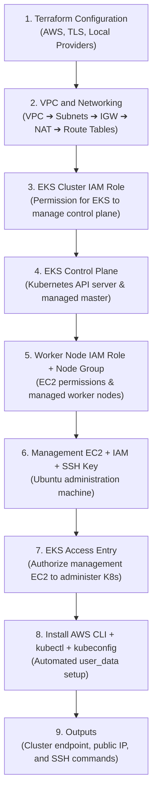

# 🚀 Complete Terraform + AWS EKS Explanation – Line by Line

> **I'll explain this in simple English, like a real-world DevOps engineer working on an AWS production project.**  
> *You already know how to create Kubernetes cluster nodes. So I'll focus on understanding what happens around those nodes, why we create each AWS resource, how the resources connect, and what purpose each Terraform line serves.*

---

## 📌 What We Will Understand
* What each Terraform block means.
* Why we need that AWS resource.
* What happens when Terraform executes it.
* How the resources communicate with each other.
* What happens after the EKS worker nodes are created.
* Important production-level security and cost considerations.

---

## 🗺️ First: Understand the Complete Architecture

Your Terraform code creates an entire EKS environment, not just Kubernetes nodes.

Think about this project like a company application:
* **EKS Control Plane:** The brain of Kubernetes.
* **Worker Nodes:** The EC2 machines where Pods run.
* **VPC:** Your private AWS network.
* **Public Subnets:** Where internet-facing resources are placed.
* **Private Subnets:** Where worker nodes are placed.
* **Internet Gateway:** Connects the VPC to the internet.
* **NAT Gateway:** Allows private resources to access the internet.
* **IAM:** Controls who or what can access AWS resources.
* **Management EC2:** Your remote administration machine.
* **kubectl:** The command-line tool used to manage Kubernetes.

---

### 🔄 Complete Execution Flow



---

## Section 1. Terraform and AWS Provider Configuration

### Your code:
```hcl
terraform {
  required_version = ">= 1.3.0"
  required_providers {
    aws = {
      source  = "hashicorp/aws"
      version = "6.73.0"
    }
    tls = {
      source  = "hashicorp/tls"
      version = "~> 4.0"
    }
    local = {
      source  = "hashicorp/local"
      version = "~> 2.0"
    }
  }
}
```

### 1. `terraform { }`
This is a Terraform settings block. It tells Terraform which version and providers are required to execute this project.
Think of it as telling your computer:
> *"Before running my infrastructure code, check whether the required Terraform environment is available."*

### 2. `required_version = ">= 1.3.0"`
* `required_version`: Specifies which Terraform CLI versions are accepted.
* `>=`: Means greater than or equal to.
* `1.3.0`: Minimum accepted version.

| Installed Terraform Version | Accepted? |
| :--- | :--- |
| `1.2.9` | ❌ No |
| `1.3.0` | ✅ Yes |
| `1.5.0` | ✅ Yes |
| `1.10.0` | ✅ Yes |

**Why do we need this?**  
Different Terraform versions can support different features and behaviours. This setting prevents someone from accidentally running your project with an unsupported older Terraform version.

### 3. `required_providers { }`
**What is a provider?**  
A provider is a plugin that allows Terraform to communicate with an external platform. Terraform itself doesn't directly know how to create an AWS EC2 instance, an Azure VM, or an AWS EKS cluster. The provider supplies that functionality.

### 4. AWS Provider
```hcl
aws = {
  source  = "hashicorp/aws"
  version = "6.73.0"
}
```
* **`aws`**: This is the local name of the provider. You will use it in your Terraform project to manage AWS resources.
* **`source = "hashicorp/aws"`**: Tells Terraform where to download the AWS provider from (`hashicorp`: Publisher, `aws`: Provider name).
* **`version = "6.73.0"`**: Specifies the exact AWS provider version.  
  *Why?* Imagine your teammate uses a different provider version. Some resource arguments or behaviours might differ. Pinning the version makes the project more predictable.

### 5. TLS Provider
```hcl
tls = {
  source  = "hashicorp/tls"
  version = "~> 4.0"
}
```
**What is TLS?**  
TLS stands for Transport Layer Security. Here, the TLS provider is used for cryptographic key generation. In your project, it generates an SSH private key and public key (we will see this in Section 9).  
*Why do we need it?* To generate SSH keys automatically instead of manually creating them outside Terraform. `~> 4.0` means Terraform accepts compatible versions from 4.0 up to, but not including, 5.0.

### 6. Local Provider
```hcl
local = {
  source  = "hashicorp/local"
  version = "~> 2.0"
}
```
**What is the Local provider?**  
It allows Terraform to interact with files on your local machine:
* Create a file.
* Write content into a file.
* Set file permissions.

In this project, it saves the generated SSH private key into a `.pem` file.

#### 📋 Summary: Why three providers?
| Provider | Purpose in this project |
| :--- | :--- |
| **AWS** | Create VPC, EKS, EC2, IAM, NAT, etc. |
| **TLS** | Generate SSH keys |
| **Local** | Save SSH private key locally |

---

### 7. AWS Provider Configuration
```hcl
provider "aws" {
  region = "ap-south-1"
}
```
* `provider "aws"`: Configures the AWS provider.
* `region = "ap-south-1"`: Tells Terraform to create AWS resources in the Mumbai region (EC2 instances, VPC, Subnets, EKS, NAT Gateway). All these resources will use this region unless a resource explicitly specifies something different.

> [!NOTE]
> **Important:** AWS credentials are also needed. Terraform can obtain them through the AWS CLI profile, environment variables, or an IAM role. For example, you can configure your local machine using `aws configure`.

---

### 8. Locals
```hcl
locals {
  cluster_name = "demo-eks-mumbai"
}
```
**What are locals?**  
Locals are reusable values inside a Terraform project. Imagine you use the cluster name in 20 different places. Instead of writing `name = "demo-eks-mumbai"` 20 times, you define it once:
```hcl
cluster_name = "demo-eks-mumbai"
```
Then reuse it:
```hcl
name = "${local.cluster_name}-cluster-role"
```
The result will be: `demo-eks-mumbai-cluster-role`

* **What is `local.cluster_name`?**  
  `local`: Refers to the locals block. `cluster_name`: The local variable.
* **Why do we use `${}`?**  
  It is Terraform interpolation syntax. It inserts a value inside a string.

---

## Section 2. VPC Networking

This is one of the most important sections. Before creating an EKS cluster, we need to prepare the AWS network.

Think about a company office:
* **VPC** = Company campus.
* **Subnets** = Different departments inside the campus.
* **Internet Gateway** = Main internet entrance.
* **NAT Gateway** = Controlled outbound internet access.
* **Route Table** = Directions telling network traffic where to go.

---

### 2.1 Create VPC
```hcl
resource "aws_vpc" "eks_vpc" {
  cidr_block           = "10.0.0.0/16"
  enable_dns_support   = true
  enable_dns_hostnames = true

  tags = {
    Name                                          = "${local.cluster_name}-vpc"
    "kubernetes.io/cluster/${local.cluster_name}" = "shared"
  }
}
```

* **Line 1: `resource "aws_vpc" "eks_vpc"`**  
  Tells Terraform to create an AWS VPC. `resource`: creating an actual AWS resource; `aws_vpc`: resource type; `eks_vpc`: Terraform's internal name for this resource. *(Note: `eks_vpc` is the Terraform reference name, not necessarily the actual AWS VPC name).*
* **Line 2: `cidr_block = "10.0.0.0/16"`**  
  What is CIDR? Classless Inter-Domain Routing. It defines the IP address range available inside the VPC. `10.0.0.0/16` provides 65,536 total IPv4 addresses. EC2 instances, network interfaces, and other AWS resources need IP addresses to communicate.
* **Line 3: `enable_dns_support = true`**  
  Enables DNS resolution inside your VPC so machines can resolve hostnames into IP addresses.
* **Line 4: `enable_dns_hostnames = true`**  
  Enables DNS hostnames for resources that receive public IP addresses.

| Setting | Purpose |
| :--- | :--- |
| **DNS support** | Resolve DNS names into IP addresses |
| **DNS hostnames** | Assign DNS hostnames to eligible resources |

*Why are both enabled?* AWS services, including EKS, rely on proper VPC DNS functionality.

* **Line 5: Tags**  
  `Name = "${local.cluster_name}-vpc"`: Shows `demo-eks-mumbai-vpc` in the AWS Console.
* **Kubernetes tag: `"kubernetes.io/cluster/${local.cluster_name}" = "shared"`**  
  Tells AWS Kubernetes integrations that this VPC resource is associated with your EKS cluster. `shared` means the resource may be shared with other Kubernetes-related resources or clusters. AWS Load Balancer Controller and other integrations use this tag for resource discovery.

---

### 2.2 Internet Gateway
```hcl
resource "aws_internet_gateway" "igw" {
  vpc_id = aws_vpc.eks_vpc.id

  tags = {
    Name = "${local.cluster_name}-igw"
  }
}
```
* **What is an Internet Gateway?** An Internet Gateway (IGW) connects your VPC to the internet (like an internet router connecting your home network to the outside world).
* **Line 1: `resource "aws_internet_gateway" "igw"`**: Creates the Internet Gateway.
* **Line 2: `vpc_id = aws_vpc.eks_vpc.id`**: Attaches the gateway to the VPC ID (`aws_vpc.eks_vpc.id`). Terraform knows the VPC must exist before attaching the gateway.

---

### 2.3 Public Subnets
You created two public subnets because you are using **two Availability Zones**:
* `ap-south-1a`
* `ap-south-1b`

An Availability Zone is an isolated AWS infrastructure location inside a region. Using multiple AZs improves availability.

#### Public Subnet 1
```hcl
resource "aws_subnet" "public_1" {
  vpc_id                  = aws_vpc.eks_vpc.id
  cidr_block              = "10.0.1.0/24"
  availability_zone       = "ap-south-1a"
  map_public_ip_on_launch = true

  tags = {
    Name                                          = "${local.cluster_name}-public-ap-south-1a"
    "kubernetes.io/cluster/${local.cluster_name}" = "shared"
    "kubernetes.io/role/elb"                      = "1"
  }
}
```
* `vpc_id`: Which VPC should contain this subnet.
* `cidr_block = "10.0.1.0/24"`: 256 total IPv4 addresses (AWS reserves 5).
* `availability_zone = "ap-south-1a"`: Places the subnet in AZ 1a.
* `map_public_ip_on_launch = true`: Instances launched here automatically receive a public IPv4 address so you can SSH into your management EC2.
* Tag `"kubernetes.io/role/elb" = "1"`: Identifies the subnet as suitable for **internet-facing load balancers**.

#### Public Subnet 2
```hcl
resource "aws_subnet" "public_2" {
  vpc_id                  = aws_vpc.eks_vpc.id
  cidr_block              = "10.0.2.0/24"
  availability_zone       = "ap-south-1b"
  map_public_ip_on_launch = true
}
```

| Property | Public Subnet 1 | Public Subnet 2 |
| :--- | :--- | :--- |
| **CIDR** | `10.0.1.0/24` | `10.0.2.0/24` |
| **AZ** | `ap-south-1a` | `ap-south-1b` |

*Why two public subnets?* An internet-facing AWS load balancer generally needs subnets in at least two Availability Zones for high availability.

---

### 2.4 Private Subnets
Now we create private subnets where resources do not have direct internet connectivity through an Internet Gateway. Your worker nodes will be placed here for security.

```hcl
resource "aws_subnet" "private_1" {
  vpc_id            = aws_vpc.eks_vpc.id
  cidr_block        = "10.0.10.0/24"
  availability_zone = "ap-south-1a"

  tags = {
    Name                                          = "${local.cluster_name}-private-ap-south-1a"
    "kubernetes.io/cluster/${local.cluster_name}" = "shared"
    "kubernetes.io/role/internal-elb"             = "1"
  }
}
```
* Tag `"kubernetes.io/role/internal-elb" = "1"`: Identifies the subnet as suitable for **internal load balancers** (e.g. for internal company applications).

#### Private Subnet 2
```hcl
resource "aws_subnet" "private_2" {
  vpc_id            = aws_vpc.eks_vpc.id
  cidr_block        = "10.0.20.0/24"
  availability_zone = "ap-south-1b"
}
```

#### 📋 Why do we have four subnets?
| Subnet | CIDR | AZ | Intended Resources |
| :--- | :--- | :--- | :--- |
| **Public Subnet 1** | `10.0.1.0/24` | `ap-south-1a` | Management EC2, Load Balancers |
| **Public Subnet 2** | `10.0.2.0/24` | `ap-south-1b` | Load Balancers |
| **Private Subnet 1** | `10.0.10.0/24` | `ap-south-1a` | EKS Worker Nodes |
| **Private Subnet 2** | `10.0.20.0/24` | `ap-south-1b` | EKS Worker Nodes |

---

### 2.5 NAT Gateway

Your worker nodes are inside private subnets without public IPs. When a worker node needs to download an image from Docker Hub (`docker pull nginx`), it uses a **NAT Gateway**.

#### First: Create Elastic IP
```hcl
resource "aws_eip" "nat" {
  domain     = "vpc"
  depends_on = [aws_internet_gateway.igw]

  tags = {
    Name = "${local.cluster_name}-nat-eip"
  }
}
```
* **Elastic IP:** A static public IPv4 address provided by AWS. A public NAT Gateway needs a public Elastic IP address to communicate with the internet.
* `domain = "vpc"`: Tells AWS that this Elastic IP is intended for VPC resources.
* `depends_on = [aws_internet_gateway.igw]`: Ensures the Internet Gateway is created before allocating the Elastic IP.

#### Second: Create NAT Gateway
```hcl
resource "aws_nat_gateway" "nat" {
  allocation_id = aws_eip.nat.id
  subnet_id     = aws_subnet.public_1.id

  tags = {
    Name = "${local.cluster_name}-nat-gw"
  }

  depends_on = [aws_internet_gateway.igw]
}
```
* `allocation_id = aws_eip.nat.id`: Uses the public Elastic IP address for the NAT Gateway.
* `subnet_id = aws_subnet.public_1.id`: Places the NAT Gateway inside public subnet 1 (must have a route to the Internet Gateway).

#### 🔄 How does NAT work?
```
Private EC2 Worker Node (10.0.10.25)
                │
                ▼ (Outbound traffic)
           NAT Gateway (Translates private source IP to public IP)
                │
                ▼
        Internet Gateway ➔ Internet / Docker Hub
                │
                ▼ (Response returns through NAT)
      Worker Node receives container images
```

> [!IMPORTANT]
> **NAT Gateway allows private resources to initiate outbound connections.** It does not allow unsolicited inbound internet connections to reach your private worker nodes.

---

### 2.6 Route Tables

A route table tells AWS where network traffic should go (like Google Maps for packets).

#### Public Route Table
```hcl
resource "aws_route_table" "public" {
  vpc_id = aws_vpc.eks_vpc.id

  route {
    cidr_block = "0.0.0.0/0"
    gateway_id = aws_internet_gateway.igw.id
  }

  tags = {
    Name = "${local.cluster_name}-public-rt"
  }
}
```
* `cidr_block = "0.0.0.0/0"`: All IPv4 destinations outside the local network.
* `gateway_id = aws_internet_gateway.igw.id`: Send internet-bound traffic to the Internet Gateway.

#### Public Subnet Associations
```hcl
resource "aws_route_table_association" "public_1" {
  subnet_id      = aws_subnet.public_1.id
  route_table_id = aws_route_table.public.id
}

resource "aws_route_table_association" "public_2" {
  subnet_id      = aws_subnet.public_2.id
  route_table_id = aws_route_table.public.id
}
```

#### Private Route Table & Associations
```hcl
resource "aws_route_table" "private" {
  vpc_id = aws_vpc.eks_vpc.id

  route {
    cidr_block     = "0.0.0.0/0"
    nat_gateway_id = aws_nat_gateway.nat.id
  }

  tags = {
    Name = "${local.cluster_name}-private-rt"
  }
}

resource "aws_route_table_association" "private_1" {
  subnet_id      = aws_subnet.private_1.id
  route_table_id = aws_route_table.private.id
}

resource "aws_route_table_association" "private_2" {
  subnet_id      = aws_subnet.private_2.id
  route_table_id = aws_route_table.private.id
}
```
* Sends external traffic from private subnets through the **NAT Gateway**.

#### 📋 Final Networking Result
| Subnet | Route Table | Internet Route |
| :--- | :--- | :--- |
| **Public 1** | Public RT | Internet Gateway |
| **Public 2** | Public RT | Internet Gateway |
| **Private 1** | Private RT | NAT Gateway |
| **Private 2** | Private RT | NAT Gateway |

> [!TIP]
> **Interview Question: Why do private subnets need a NAT Gateway?**  
> *Answer:* Private subnet resources don't have direct internet access. However, worker nodes may need to download container images, install OS updates, or access external APIs. A NAT Gateway allows these outbound connections without exposing worker nodes directly to the internet.
> 
> *Production Point:* Your current design has one NAT Gateway in AZ 1a shared by both private subnets. For high availability in production, deploy one NAT Gateway per AZ.

---

## Section 3. EKS Cluster IAM Role

IAM (Identity and Access Management) controls:
* Who can access AWS?
* What actions can they perform?
* Which AWS services can perform actions?

Your EKS control plane needs an IAM role because AWS EKS must interact with other AWS services to manage the Kubernetes control plane.

### 3.1 Your code:
```hcl
resource "aws_iam_role" "cluster" {
  name = "${local.cluster_name}-cluster-role"

  assume_role_policy = jsonencode({
    Version = "2012-10-17"
    Statement = [
      {
        Action = "sts:AssumeRole"
        Effect = "Allow"
        Principal = {
          Service = "eks.amazonaws.com"
        }
      }
    ]
  })
}
```
* `assume_role_policy`: The trust policy defining WHO is allowed to assume the role. `jsonencode()` converts Terraform syntax into valid JSON.
* `Action = "sts:AssumeRole"`: Allows requesting temporary role credentials via AWS Security Token Service.
* `Principal = { Service = "eks.amazonaws.com" }`: Tells AWS to allow the Amazon EKS service to assume this role.

### 3.2 Attach EKS Cluster Policy
```hcl
resource "aws_iam_role_policy_attachment" "cluster_policy" {
  policy_arn = "arn:aws:iam::aws:policy/AmazonEKSClusterPolicy"
  role       = aws_iam_role.cluster.name
}
```
* **Trust policy:** Who can use the role? (`eks.amazonaws.com`)
* **Permission policy:** What can the role do? (`AmazonEKSClusterPolicy`)

---

## Section 4. EKS Cluster – Control Plane

```hcl
resource "aws_eks_cluster" "main" {
  name     = local.cluster_name
  role_arn = aws_iam_role.cluster.arn
  version  = "1.31"

  vpc_config {
    endpoint_private_access = true
    endpoint_public_access  = true
    subnet_ids = [
      aws_subnet.public_1.id,
      aws_subnet.public_2.id,
      aws_subnet.private_1.id,
      aws_subnet.private_2.id
    ]
  }

  access_config {
    authentication_mode                         = "API_AND_CONFIG_MAP"
    bootstrap_cluster_creator_admin_permissions = true
  }

  depends_on = [
    aws_iam_role_policy_attachment.cluster_policy
  ]

  tags = {
    Name = local.cluster_name
  }
}
```

### 4.1 Create EKS Resource
* `name = local.cluster_name`: `demo-eks-mumbai`.
* `role_arn = aws_iam_role.cluster.arn`: Passes the IAM role created in Section 3.
* `version = "1.31"`: Kubernetes control plane version.

### 4.2 VPC Configuration
* `endpoint_private_access = true`: Clients inside the VPC can access the Kubernetes API endpoint through private networking.
* `endpoint_public_access = true`: Reachable over the public internet.
* `subnet_ids`: Subnets from two Availability Zones where AWS places its control-plane network interfaces.

### 4.3 Access Configuration
* `authentication_mode = "API_AND_CONFIG_MAP"`: Enables both modern EKS Access Entries and legacy `aws-auth` ConfigMap.
* `bootstrap_cluster_creator_admin_permissions = true`: Grants the IAM identity running Terraform cluster-admin permissions inside Kubernetes.

### 4.4 `depends_on`
Ensures Terraform waits for the IAM policy attachment before creating the cluster.

---

## Section 5. EKS Node Group IAM Role

| IAM Role | Used by | Purpose |
| :--- | :--- | :--- |
| **Cluster Role** | EKS Service | Manage the EKS control plane |
| **Node Role** | Worker EC2 instances | Allow worker nodes to interact with AWS services |
| **Management Role** | Ubuntu management EC2 | Allow administration machine to call AWS APIs |

```hcl
resource "aws_iam_role" "nodes" {
  name = "${local.cluster_name}-node-group-role"

  assume_role_policy = jsonencode({
    Version = "2012-10-17"
    Statement = [
      {
        Action = "sts:AssumeRole"
        Effect = "Allow"
        Principal = {
          Service = "ec2.amazonaws.com"
        }
      }
    ]
  })
}
```
* `Principal = { Service = "ec2.amazonaws.com" }`: Intended for EC2 worker instances.

### 5.2 Attach Worker Node Policies
1. **`AmazonEKSWorkerNodePolicy`**: Permissions needed by worker nodes to participate in an EKS cluster.
2. **`AmazonEKS_CNI_Policy`**: Allows the AWS VPC CNI plugin to assign VPC IP addresses directly to Pods.
3. **`AmazonEC2ContainerRegistryReadOnly`**: Allows worker nodes to pull container images from Amazon ECR.

---

## Section 6. EKS Managed Node Group

```hcl
resource "aws_eks_node_group" "main" {
  cluster_name    = aws_eks_cluster.main.name
  node_group_name = "managed-worker-nodes"
  node_role_arn   = aws_iam_role.nodes.arn
  subnet_ids = [
    aws_subnet.private_1.id,
    aws_subnet.private_2.id
  ]

  capacity_type  = "ON_DEMAND"
  instance_types = ["t3.small"]

  scaling_config {
    desired_size = 2
    min_size     = 1
    max_size     = 3
  }

  update_config {
    max_unavailable = 1
  }

  depends_on = [
    aws_iam_role_policy_attachment.nodes_worker_policy,
    aws_iam_role_policy_attachment.nodes_cni_policy,
    aws_iam_role_policy_attachment.nodes_ecr_policy
  ]

  tags = {
    Name = "${local.cluster_name}-worker-node"
  }
}
```

* **`subnet_ids`**: Worker nodes are placed in private subnets for security and high availability.
* **`capacity_type = "ON_DEMAND"`**: Runs predictable, stable compute without Spot launch failures on Free Tier / new accounts.
* **`instance_types = ["t3.small"]`**: 2 vCPUs, 2 GiB RAM, up to 11 Pods (~$0.02/hr, perfect balance of reliability and cost).
* **`scaling_config`**: Initial desired 2, minimum 1, maximum 3.
* **`update_config { max_unavailable = 1 }`**: During updates, at most one node is taken down at a time.
* **`depends_on`**: Ensures all 3 node IAM policies are attached before nodes launch.

### 6.1 AWS EBS CSI Driver Add-on (Persistent Storage for 100 GB PVCs)

```hcl
resource "aws_iam_role_policy_attachment" "nodes_ebs_csi_policy" {
  policy_arn = "arn:aws:iam::aws:policy/service-role/AmazonEBSCSIDriverPolicy"
  role       = aws_iam_role.nodes.name
}

resource "aws_eks_addon" "ebs_csi" {
  cluster_name = aws_eks_cluster.main.name
  addon_name   = "aws-ebs-csi-driver"

  depends_on = [
    aws_eks_node_group.main,
    aws_iam_role_policy_attachment.nodes_ebs_csi_policy
  ]
}
```

* **`AmazonEBSCSIDriverPolicy`**: Gives worker nodes permission to call AWS EC2 APIs (`ec2:CreateVolume`, `ec2:AttachVolume`, `ec2:DeleteVolume`, `ec2:ModifyVolume`).
* **`aws_eks_addon.ebs_csi`**: Installs the Container Storage Interface driver so Kubernetes can dynamically provision AWS EBS volumes when a PVC requests storage (such as 100 GiB).

---

## Section 7. IAM Role and Instance Profile for Ubuntu Management EC2

To manage the EKS cluster (`kubectl get nodes`), we create an **Ubuntu Management Server (Bastion Host)**.

### 7.1 Create Management IAM Role
```hcl
resource "aws_iam_role" "management_node" {
  name = "${local.cluster_name}-management-role"

  assume_role_policy = jsonencode({
    Version = "2012-10-17"
    Statement = [
      {
        Action = "sts:AssumeRole"
        Effect = "Allow"
        Principal = {
          Service = "ec2.amazonaws.com"
        }
      }
    ]
  })
}
```

### 7.2 Attach `AdministratorAccess`
```hcl
resource "aws_iam_role_policy_attachment" "management_admin" {
  policy_arn = "arn:aws:iam::aws:policy/AdministratorAccess"
  role       = aws_iam_role.management_node.name
}
```
* Makes it easy to call AWS APIs and administer the cluster. *(In production, use least-privilege IAM policies instead).*

### 7.3 Instance Profile
```hcl
resource "aws_iam_instance_profile" "management_profile" {
  name = "${local.cluster_name}-management-profile"
  role = aws_iam_role.management_node.name
}
```
* **Instance Profile:** The bridge that allows the EC2 instance to receive temporary IAM credentials via the instance metadata service without manually storing access keys on the server.

---

## Section 8. EKS Access Entry – Authorize Management EC2 as Kubernetes Admin

> [!IMPORTANT]
> **AWS IAM access and Kubernetes access are two different things.**  
> Attaching an AWS IAM role does not automatically allow `kubectl get nodes`. You must authorize the IAM role inside Kubernetes using **EKS Access Entries**.

### 8.1 Create Access Entry
```hcl
resource "aws_eks_access_entry" "management" {
  cluster_name  = aws_eks_cluster.main.name
  principal_arn = aws_iam_role.management_node.arn
  type          = "STANDARD"

  depends_on = [aws_eks_cluster.main]
}
```

### 8.2 Associate EKS Admin Policy
```hcl
resource "aws_eks_access_policy_association" "management_admin" {
  cluster_name  = aws_eks_cluster.main.name
  policy_arn    = "arn:aws:eks::aws:cluster-access-policy/AmazonEKSClusterAdminPolicy"
  principal_arn = aws_iam_role.management_node.arn

  access_scope {
    type = "cluster"
  }

  depends_on = [aws_eks_access_entry.management]
}
```
* Associates `AmazonEKSClusterAdminPolicy` at the cluster scope.

#### 🔄 Complete Authentication Flow:
```
1. Ubuntu Management EC2 runs kubectl
   │
2. IAM Role provides temporary credentials via Instance Profile
   │
3. AWS CLI generates EKS authentication token
   │
4. EKS API Server validates IAM identity
   │
5. Access Entry & Policy recognizes role as Cluster Admin
   │
6. Kubernetes API responds: kubectl get nodes displays worker nodes!
```

---

## Section 9. Automatic SSH Key Generation for Management EC2

```hcl
resource "tls_private_key" "mgmt_key" {
  algorithm = "RSA"
  rsa_bits  = 4096
}

resource "local_file" "mgmt_key_pem" {
  content         = tls_private_key.mgmt_key.private_key_pem
  filename        = "${path.module}/management_key.pem"
  file_permission = "0400"
}

resource "aws_key_pair" "mgmt_key" {
  key_name   = "${local.cluster_name}-mgmt-key"
  public_key = tls_private_key.mgmt_key.public_key_openssh
}
```

* `tls_private_key`: Generates a 4096-bit RSA key pair.
* `local_file`: Saves `management_key.pem` locally with `0400` read-only permissions.
* `aws_key_pair`: Uploads the public key to AWS so you can connect via SSH.

---

## Section 10. Security Group for Management EC2

```hcl
resource "aws_security_group" "management_sg" {
  name        = "${local.cluster_name}-management-sg"
  description = "Allow SSH access to management EC2"
  vpc_id      = aws_vpc.eks_vpc.id

  ingress {
    description = "SSH from anywhere"
    from_port   = 22
    to_port     = 22
    protocol    = "tcp"
    cidr_blocks = ["0.0.0.0/0"]
  }

  egress {
    description = "Allow all outbound traffic"
    from_port   = 0
    to_port     = 0
    protocol    = "-1"
    cidr_blocks = ["0.0.0.0/0"]
  }

  tags = {
    Name = "${local.cluster_name}-management-sg"
  }
}
```
* **Ingress:** Allows TCP Port 22 (SSH) from `0.0.0.0/0`.
* **Egress:** Allows all outbound traffic so the instance can download AWS CLI, `kubectl`, and Ubuntu packages.

### 10.1 EKS Control Plane Ingress Rule (Port 443)

```hcl
resource "aws_security_group_rule" "cluster_inbound_from_management" {
  type                     = "ingress"
  from_port                = 443
  to_port                  = 443
  protocol                 = "tcp"
  source_security_group_id = aws_security_group.management_sg.id
  security_group_id        = aws_eks_cluster.main.vpc_config[0].cluster_security_group_id
  description              = "Allow management EC2 to communicate with EKS API server"
}
```

* **Why is this rule required?**
  With `endpoint_private_access = true`, any EC2 inside the VPC resolves the EKS API endpoint to the private ENI IP address (e.g. `10.0.2.192`). 
* **The `i/o timeout` Issue:** Without this rule, the automatic EKS cluster security group silently blocks incoming traffic on port 443 from the management server, causing:
  `Get "https://...eks.amazonaws.com/api?timeout=32s": dial tcp 10.0.2.192:443: i/o timeout`
* **The Fix:** Attaching this rule explicitly opens port 443 for `aws_security_group.management_sg.id`, allowing `kubectl get nodes` to work immediately.

---

## Section 11. Ubuntu Management EC2 Instance

### 11.1 Dynamic AMI Query
```hcl
data "aws_ami" "ubuntu" {
  most_recent = true
  owners      = ["099720109477"] # Canonical

  filter {
    name   = "name"
    values = ["ubuntu/images/hvm-ssd/ubuntu-jammy-22.04-amd64-server-*"]
  }

  filter {
    name   = "virtualization-type"
    values = ["hvm"]
  }
}
```
* Searches AWS for the newest official Ubuntu 22.04 LTS AMI.

### 11.2 Create EC2 & User Data Automation
```hcl
resource "aws_instance" "management_server" {
  ami                         = data.aws_ami.ubuntu.id
  instance_type               = "t3.micro"
  subnet_id                   = aws_subnet.public_1.id
  vpc_security_group_ids      = [aws_security_group.management_sg.id]
  key_name                    = aws_key_pair.mgmt_key.key_name
  iam_instance_profile        = aws_iam_instance_profile.management_profile.name
  associate_public_ip_address = true

  user_data = <<-EOF
              #!/bin/bash
              export DEBIAN_FRONTEND=noninteractive
              apt-get update -y
              apt-get install -y curl unzip git

              # 1. Install AWS CLI v2
              curl "https://awscli.amazonaws.com/awscli-exe-linux-x86_64.zip" -o "/tmp/awscliv2.zip"
              unzip -q /tmp/awscliv2.zip -d /tmp
              /tmp/aws/install

              # 2. Install kubectl
              curl -LO "https://dl.k8s.io/release/v1.31.0/bin/linux/amd64/kubectl"
              chmod +x kubectl
              mv kubectl /usr/local/bin/

              # 3. Configure kubeconfig
              mkdir -p /home/ubuntu/.kube
              aws eks update-kubeconfig --region ap-south-1 --name ${aws_eks_cluster.main.name} --kubeconfig /home/ubuntu/.kube/config
              chown -R ubuntu:ubuntu /home/ubuntu/.kube

              # 4. Aliases
              echo 'alias k=kubectl' >> /home/ubuntu/.bashrc
              echo 'source <(kubectl completion bash)' >> /home/ubuntu/.bashrc
              echo 'complete -o default -F __start_kubectl k' >> /home/ubuntu/.bashrc

              echo "SETUP_COMPLETE" > /tmp/ready.txt
              EOF

  depends_on = [
    aws_eks_cluster.main,
    aws_eks_node_group.main,
    aws_eks_access_policy_association.management_admin
  ]

  tags = {
    Name = "${local.cluster_name}-management-server"
  }
}
```

* **`user_data`**: Multi-line script executed automatically during initial boot.
* **`export DEBIAN_FRONTEND=noninteractive`**: Prevents interactive prompts from freezing the automated installation.
* **AWS CLI & `kubectl`**: Installed to `/usr/local/bin`.
* **`aws eks update-kubeconfig`**: Interpolates the cluster name and writes config to `/home/ubuntu/.kube/config`.
* **`chown -R ubuntu:ubuntu`**: Ensures the `ubuntu` user owns the generated configuration.
* **`depends_on`**: Ensures the EKS cluster, worker nodes, and IAM admin policy exist before the management instance runs `update-kubeconfig`.

---

## Section 12. Outputs

```hcl
output "cluster_name" {
  description = "The name of the EKS Cluster"
  value       = aws_eks_cluster.main.name
}

output "cluster_endpoint" {
  description = "Kubernetes API server endpoint"
  value       = aws_eks_cluster.main.endpoint
}

output "management_server_public_ip" {
  description = "Public IP address of the Ubuntu Management EC2"
  value       = aws_instance.management_server.public_ip
}

output "ssh_to_management_server" {
  description = "Command to SSH into the Management EC2 server"
  value       = "ssh -i ${path.module}/management_key.pem ubuntu@${aws_instance.management_server.public_ip}"
}

output "instant_k8s_test_command" {
  description = "Command to test Kubernetes directly from your local terminal"
  value       = "ssh -i ${path.module}/management_key.pem ubuntu@${aws_instance.management_server.public_ip} 'kubectl get nodes'"
}
```

---

## Section 13. What Happens After Terraform Finishes?

### Practical Workflow:

1. **Initialize Terraform:** `terraform init` (downloads AWS, TLS, and Local plugins).
2. **Validate Configuration:** `terraform validate` (checks syntax).
3. **Review Execution Plan:** `terraform plan` (previews resources to create).
4. **Apply Infrastructure:** `terraform apply` (provisions VPC, EKS, Node Group, and Management EC2).
5. **Check Outputs:** `terraform output`.
6. **Connect to Management EC2:**
   ```powershell
   ssh -i management_key.pem ubuntu@YOUR_PUBLIC_IP
   ```
7. **Verify Installations:**
   ```bash
   aws --version
   kubectl version --client
   aws sts get-caller-identity
   ```
8. **Verify Kubernetes Cluster:**
   ```bash
   kubectl get nodes
   kubectl get pods -A
   kubectl cluster-info
   ```

---

## Section 14. What Should You Do After Creating the Cluster?

* **Verify Worker Nodes:** `kubectl get nodes -o wide` (check Ready status and IPs).
* **Check System Pods:** `kubectl get pods -n kube-system` (verify CoreDNS, kube-proxy, AWS VPC CNI).
* **Configure AWS Load Balancer Controller:** Install via Helm to provision ALBs/NLBs.
* **Configure Storage:** Install EBS CSI driver for persistent volumes.
* **Configure Monitoring:** Deploy Prometheus and Grafana.
* **Deploy Applications:** Deploy containerized workloads using Deployments, Services, and Ingress.
* **Configure CI/CD:** Connect GitLab, Jenkins, or GitHub Actions.

---

## Section 15. Important Issues in Your Current Terraform Code

| Current Configuration | What You Should Understand |
| :--- | :--- |
| `version = "1.31"` | Check current EKS version support in your region before deploying. |
| `capacity_type = "ON_DEMAND"` | Ensures rock-solid stability and avoids Free-Tier Spot launch restrictions (`InvalidParameterCombination`). |
| `t3.small` | 2 vCPUs, 2 GiB RAM (up to 11 pods) — low cost (~$0.02/hr) with sufficient memory for system daemons. |
| **One NAT Gateway** | Single-AZ dependency; production setups should deploy one per AZ. |
| `AdministratorAccess` | Excessively broad management permissions; use least-privilege policies in production. |
| `SSH 0.0.0.0/0` | Allows connection attempts from anywhere; restrict to trusted IP or use AWS SSM. |
| **Public EKS Endpoint** | Restrict allowed public IP ranges using `public_access_cidrs`. |
| **Private Key in State** | Protect your `.tfstate` file as a sensitive credential store; never commit to Git. |
| `most_recent = true` | A new AMI may be selected on a future plan if Canonical publishes an update. |
| **User Data Error Handling** | Add logging (`set -e`) to catch installation issues in production scripts. |
